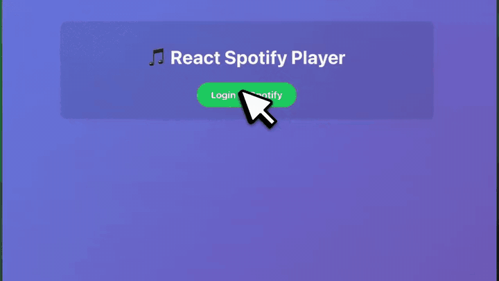

# React Spotify Player - Modern Educational Example



What React Spotify Player looked like in November 2026, recorded for [its page on joekarlsson.com](https://www.joekarlsson.com/work/react-spotify-player/). The full-quality video is [2026-11-recording.mp4](.github/readme/2026-11-recording.mp4).

> **Heads up:** this app logs in with Spotify's Implicit Grant flow, which Spotify deprecated in November 2025. It's fine for following the tutorial, but new apps should use the [Authorization Code flow with PKCE](https://developer.spotify.com/documentation/web-api/tutorials/code-pkce-flow) instead.

A modern React application demonstrating Spotify Web API integration using Vite. This example shows how to:

- Authenticate with Spotify using OAuth 2.0
- Fetch currently playing track information
- Display track details and playback status
- Update information in real-time

## Features

- **Modern build tool** - Uses Vite for fast development and building
- **Minimal dependencies** - Only React and Vite
- **Educational focus** - Clean, readable code following React best practices
- **Real-time updates** - Polls Spotify API every 5 seconds
- **Modern React patterns** - Uses functional components and hooks

## Setup

1. **Create a Spotify App**:
   - Go to [Spotify Developer Dashboard](https://developer.spotify.com/dashboard)
   - Create a new app
   - Add `http://localhost:3001` to Redirect URIs (it has to match `redirectUri` in `src/config/spotify.js`)

2. **Configure the app**:
   - Open `src/config/spotify.js`
   - Replace the client ID with your Spotify app's Client ID (already configured!)

3. **Install dependencies and run**:

   ```bash
   npm install
   npm run dev
   ```

4. **Open your browser**:
   - Vite will automatically open `http://localhost:3001`
   - Click "Login to Spotify"
   - Authorize the app
   - Start playing music in Spotify!

## How it Works

### Authentication Flow

1. User clicks "Login to Spotify"
2. Redirects to Spotify's authorization endpoint
3. User authorizes the app
4. Spotify redirects back with access token in URL fragment
5. App extracts token and stores it

### API Integration

- Uses Spotify Web API `/me/player` endpoint
- Fetches currently playing track information
- Updates UI with track name, artist, album art, and progress
- Polls every 5 seconds for real-time updates

### Key Learning Points

- **OAuth 2.0 Implicit Grant Flow** - Client-side authentication (deprecated by Spotify in November 2025)
- **Fetch API** - Modern JavaScript for HTTP requests
- **React Hooks** - useState, useEffect, useCallback for state management
- **Error Handling** - Proper try/catch and user feedback
- **Real-time Updates** - Polling pattern for live data

## File Structure

```
├── index.html              # Main HTML template
├── vite.config.js          # Vite configuration
├── package.json            # Dependencies and scripts
├── src/
│   ├── main.jsx           # Entry point that renders the app
│   ├── App.jsx            # Main App component with authentication logic
│   ├── index.css          # Global styles
│   ├── components/
│   │   └── Player.jsx     # Player component for displaying track info
│   ├── config/
│   │   └── spotify.js     # Spotify API configuration
│   └── utils/
│       └── hash.js         # URL hash parsing utility
└── README.md              # This file
```

## Dependencies

- **React 18** - Modern UI framework
- **Vite** - Fast build tool and dev server
- **@vitejs/plugin-react** - React support for Vite

That's it! No complex build configuration needed.

## Educational Value

This minimal example teaches:

- Spotify Web API authentication
- React functional components and hooks
- Modern JavaScript (async/await, fetch)
- OAuth 2.0 flow implementation
- Real-time data polling
- Error handling patterns

Perfect for understanding how to integrate external APIs with React applications!

## Code Organization

Each file has a specific purpose following modern React best practices:

- **`src/config/spotify.js`** - Contains all Spotify API configuration (endpoints, client ID, scopes)
- **`src/utils/hash.js`** - Utility function to parse OAuth tokens from URL fragments
- **`src/components/Player.jsx`** - React component that displays track information and progress
- **`src/App.jsx`** - Main component handling authentication, API calls, and state management
- **`src/main.jsx`** - Entry point that renders the React app
- **`index.html`** - HTML template for the application

This structure follows modern React conventions:

- Components in separate files with `.jsx` extension
- Configuration separated from components
- Utilities in dedicated folders
- Clear separation of concerns

## 📚 Educational Resources

### 📖 Additional Documentation

- **[Troubleshooting Guide](./TROUBLESHOOTING.md)** - Comprehensive guide for resolving common issues
- **[API Endpoints Guide](./API_ENDPOINTS_GUIDE.md)** - Examples of additional Spotify API endpoints to explore
- **[Contributing Guide](./CONTRIBUTING.md)** - How to contribute to this educational project
- **[Blog Post](https://medium.com/@joekarlsson/how-to-build-a-spotify-player-with-react-in-15-minutes-7e01991bc4b6)** - Original tutorial: "How to Build A Spotify Player with React in 15 Minutes"

### 🎯 Learning Path

1. **Start Here**: Follow the Quick Start guide above
2. **Understand the Code**: Read the detailed comments in `src/App.jsx` and `src/components/Player.jsx`
3. **Troubleshoot Issues**: Check the [Troubleshooting Guide](./TROUBLESHOOTING.md) if you encounter problems
4. **Expand Your Skills**: Explore additional endpoints in the [API Endpoints Guide](./API_ENDPOINTS_GUIDE.md)
5. **Build More Features**: Use the examples to add playlists, search, or recommendations

### 🔗 External Resources

- **[Spotify Web API Documentation](https://developer.spotify.com/documentation/web-api/)** - Official API reference
- **[Spotify Developer Dashboard](https://developer.spotify.com/dashboard)** - Manage your app settings
- **[React Documentation](https://reactjs.org/docs/getting-started.html)** - Learn React fundamentals
- **[OAuth 2.0 Guide](https://developer.spotify.com/documentation/general/guides/authorization-guide/)** - Understanding Spotify's authentication

## 📄 License

This project is licensed under the MIT License - see the [LICENSE](./LICENSE) file for details.

## 🤝 Contributing

Contributions are welcome! Please read our [Contributing Guide](./CONTRIBUTING.md) for details on our code of conduct and the process for submitting pull requests.

## 👨‍💻 Author

**Joe Karlsson**

- 🐦 **Twitter**: [@JoeKarlsson1](https://twitter.com/JoeKarlsson1)
- 💻 **GitHub**: [@JoeKarlsson](https://github.com/joekarlsson/)
- 💼 **LinkedIn**: [/in/joekarlsson](https://www.linkedin.com/in/joekarlsson/)
- 🌐 **Website**: [joekarlsson.com](https://www.joekarlsson.com/)

---

⭐ **Star this repository if you found it helpful!**
